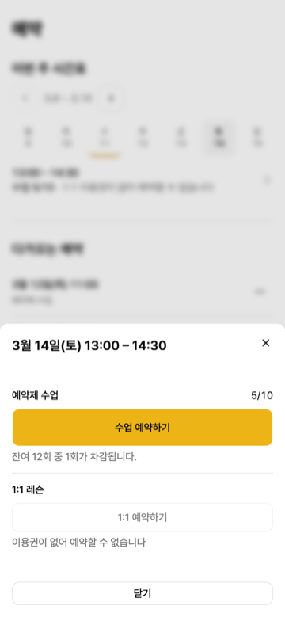
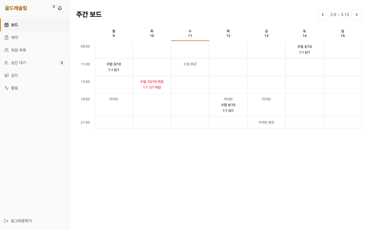

# 골드레슬링 — 체육관 회원·예약 서비스

레슬링 체육관의 회원·이용권·예약을 관리하는 풀스택 웹 서비스입니다.
요구사항·도메인 정책·아키텍처 설계와 검증 게이트는 직접 담당하고,
구현은 AI 에이전트(Claude Code + GSD)와 협업한 1인 프로젝트의 기록입니다.

**📄 사이트에서 보기 → https://minsu-zip.github.io/gold-wrestling-docs/**

<p>
  
  
</p>

v1.0 요구사항 85건 충족 · 의사결정 기록 194건 · BE 테스트 885건 · FE 테스트 1,673건
(2026-09-17, 두 레포 실측 기준)

## 무엇이 있나

| 페이지 | 내용 |
| --- | --- |
| [홈](https://minsu-zip.github.io/gold-wrestling-docs/) | 서비스 소개, 수치, FE/BE 파트(화면·아키텍처·트러블슈팅·UI 검사·핵심 설계), 타임라인 |
| [프로젝트 현황](https://minsu-zip.github.io/gold-wrestling-docs/status/) | 완료·진행 예정·인프라 준비 상태. 마일스톤마다 갱신 |
| [하이라이트](https://minsu-zip.github.io/gold-wrestling-docs/highlights/concurrency) | 동시성 제어 · 멱등 배치 · 계약 기반 협업 · UI 감사 — 문제 → 결정 → 검증 |
| [아키텍처](https://minsu-zip.github.io/gold-wrestling-docs/architecture) | 현재 구조와 배포 목표 구성 |
| [AI 협업 워크플로](https://minsu-zip.github.io/gold-wrestling-docs/ai-workflow/) | 사람이 결정·검증하고 AI가 구현한 방식과 실제 산출물 |

## 원본 레포

- 프론트엔드 [gold-wrestling-fe](https://github.com/minsu-zip/gold-wrestling-fe) —
  React 19 · TypeScript · Vite · TanStack Query · Storybook · Playwright
- 백엔드 [gold-wrestling-be](https://github.com/minsu-zip/gold-wrestling-be) —
  Kotlin · Spring Boot 4.1 · PostgreSQL · Flyway

사이트의 수치와 결정 번호(D-xxx)는 두 레포의 `docs/`와 `.planning/`이 정본입니다.
결정 기록 전체: [decisions.md](https://github.com/minsu-zip/gold-wrestling-be/blob/dev/docs/decisions.md)

## 로컬 실행

VitePress 사이트입니다. 패키지 매니저는 pnpm으로 고정되어 있습니다.

```bash
pnpm install
pnpm docs:dev       # http://localhost:5173/gold-wrestling-docs/
pnpm docs:build
pnpm docs:preview
```

`main`에 푸시하면 GitHub Actions가 빌드해 GitHub Pages로 배포합니다 (`.github/workflows/deploy.yml`).

## 구조

```text
.vitepress/
  config.mts          사이트 설정 · 사이드바
  theme/Landing.vue   홈 랜딩 (시맨틱 HTML + CSS)
  theme/custom.css    스타일
public/shots/         화면 캡처 (모바일 360px · 데스크탑 640~720px)
highlights/           하이라이트 4편
status/ · architecture.md · ai-workflow/
CAPTURE-LIST.md       스크린샷·GIF 촬영 목록과 교체 시점
TODO.md               다음에 챙길 일
```
