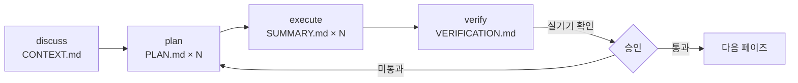

# AI 협업 워크플로

코드는 AI 에이전트가 썼습니다. 저는 요구사항을 정하고, 도메인 정책을 결정하고, 아키텍처와 기술을 골랐고, 검증 게이트를 운영했습니다. 그 운영이 실제로 어떤 파일과 절차로 돌아갔는지 적습니다.

| 도구 | 역할 |
| --- | --- |
| Claude Code | 코드·테스트·문서 작성. 규칙은 각 레포 `CLAUDE.md`와 `.claude/skills/`로 주입 |
| GSD | 페이즈 단위 워크플로. `.planning/` 아래 로드맵·요구사항·플랜·검증 문서를 만들고 상태를 추적 |
| GitHub Actions | CI 게이트. PR마다 규칙 위반을 코멘트하는 워크플로 포함 |

## 리듬



제가 개입하는 지점은 정해져 있습니다.

- **discuss** 질문에 답하고 결정합니다. 답은 D-번호로 남습니다.
- **plan** 플랜 체커가 목표 역산으로 검증한 뒤 범위와 순서를 승인합니다.
- **execute** 개입하지 않습니다. 대신 자동 커밋을 금지해 모든 변경을 보고 커밋합니다.
- **verify** 검증 문서를 읽고, 실기기로 확인하고, 항목별로 통과·미통과를 판정합니다.

FE 레포 `.planning/`의 Phase 9 산출물입니다. 플랜 9개, 재감사 대조, 실기기 게이트 기록까지 전부 파일입니다.

```text
.planning/
  PROJECT.md · REQUIREMENTS.md · ROADMAP.md · STATE.md
  RETROSPECTIVE.md · BE-CHANGE-REQUESTS.md · config.json
  phases/09-member-screens/
    09-CONTEXT.md            discuss 결과
    09-RESEARCH.md · 09-PATTERNS.md
    09-01-PLAN.md … 09-09-PLAN.md
    09-01-SUMMARY.md … 09-09-SUMMARY.md
    09-AUDIT-DIFF.md         before/after 재감사 대조
    09-DEVICE-GATE.md        실기기 확인 기록
    09-VERIFICATION.md       성공 기준 5/5
```

## 두 레포를 정렬하는 단일 진실

FE 세션과 BE 세션은 서로의 코드를 읽지 않고 BE 레포의 `docs/`만 함께 읽습니다.

| 파일 | 역할 |
| --- | --- |
| `policies.md` | 차감·예약·상태 규칙. 코드가 문서와 다르면 코드가 틀린 것 |
| `glossary.md` | 두 레포가 같은 이름을 쓰게 하는 용어집 |
| `error-codes.md` | FE가 분기하는 `code` 값의 유일한 계약 |
| `api/openapi.yaml` | API 계약. 없는 API는 구현하지 않음 |
| `decisions.md` | 결정 186건. FE 결정도 같은 파일에 D-번호로 |

## 게이트

| 게이트 | 막는 것 |
| --- | --- |
| 자동 커밋 금지 | AI가 확인 없이 커밋·푸시하는 것 |
| CI | lint · typecheck · unit · storybook · E2E(FE), ktlint · build · 통합 테스트(BE) |
| PR 리뷰 워크플로 | 수기 API 타입, 계약 밖 호출, lockfile 혼입 같은 규칙 위반 |
| 감사 리포트 승인 | 측정 없이 화면을 고치는 것 |
| 실기기 확인 | 에뮬레이션이 못 잡는 모바일 문제 |
| 페이즈 게이트 플랜 | 마일스톤 말미의 빅뱅 검증. 페이즈마다 전체 스위트와 계약 감사를 반복 |

## 회고

**잘된 것.** 계약 우선 규율로 재작업 0건. 페이즈 게이트 덕에 마감 페이즈가 새 검증이 아니라 재확인이 됐습니다. 순수 함수 판정 분리와 MSW 단일 목 계층으로 서버 없이 전 상태를 검증했습니다.

**비효율.** 이월 항목이 페이즈 2~3개를 건너 해소됐습니다. 콜드런 플레이크가 반복됐습니다. E2E 시드 헬퍼가 11개 스펙에 복제된 채 마일스톤을 넘겼습니다.

**교훈.** "위반 0건"은 검사 범위와 한계를 짝으로 적어야 합니다. "등록 완료"와 "실제 강제"는 다릅니다. GitHub Free + private에서는 브랜치 보호가 저장돼도 강제되지 않았습니다.
