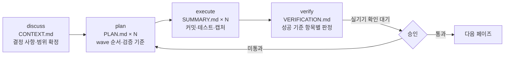

# AI 협업 워크플로

이 프로젝트에서 코드는 AI 에이전트가 썼다. 나는 요구사항을 정하고, 도메인 정책을 결정하고, 아키텍처와 기술을 골랐고, 검증 게이트를 운영했다. 이 페이지는 그 운영 방식이 실제로 어떤 파일과 절차로 돌아갔는지 적는다. 근거는 두 레포에 있는 산출물뿐이다.

## 도구

| 도구 | 역할 |
| --- | --- |
| Claude Code | 코드 작성, 테스트 작성, 문서 갱신. 프로젝트 규칙은 각 레포 `CLAUDE.md`와 `.claude/skills/`로 주입 |
| GSD (Get Shit Done) | 페이즈 단위 워크플로 엔진. `.planning/` 아래 로드맵·요구사항·플랜·검증 문서를 만들고 상태를 추적 |
| GitHub Actions | CI 게이트. PR마다 규칙 위반을 코멘트하는 `claude-pr-review` 워크플로 포함 |

## 리듬: discuss → plan → execute → verify

페이즈마다 네 단계가 돈다. 각 단계의 산출물이 파일로 남고, 다음 단계는 그 파일만 읽는다.



내가 개입하는 지점은 정해져 있다.

- **discuss**: 질문에 답하고 결정한다. 답은 `CONTEXT.md`에 D-번호로 남는다. 예를 들어 FE Phase 9의 `09-CONTEXT.md`, `09-DISCUSSION-LOG.md`.
- **plan 검토**: 플랜 체커가 목표 역산으로 플랜을 검증한 뒤, 내가 범위와 순서를 승인한다.
- **execute**: 개입하지 않는다. 대신 자동 커밋을 전면 금지해(`commit_docs: false`) 모든 변경을 내가 보고 커밋한다.
- **verify**: 검증 문서를 읽고, 실기기로 확인하고, 통과/미통과를 판정한다. 모든 페이즈 verify에 "실기기 확인 대기" 체크포인트가 있다.

### 실제 파일 구조

FE 레포 `.planning/`의 현재 모습이다. 페이즈 9는 플랜 9개, 검증 문서, 감사 대조, 실기기 게이트 기록까지 전부 파일이다.

```text
.planning/
  PROJECT.md              프로젝트 정의 · 핵심 가치 · 제약
  REQUIREMENTS.md         이번 마일스톤 요구사항 (ID 단위)
  ROADMAP.md              페이즈 · 성공 기준 · 의존
  STATE.md                현재 위치 · 이월 항목 · 실측 속도
  MILESTONES.md           마감된 마일스톤 통계
  RETROSPECTIVE.md        회고 (잘된 것 · 비효율 · 교훈)
  BE-CHANGE-REQUESTS.md   FE → BE 계약 요청 (누적)
  config.json             워크플로 토글 (자동 커밋 금지 · 리서치 · 플랜 체크 · UI 게이트)
  milestones/
    v1.0-ROADMAP.md       아카이브
    v1.0-REQUIREMENTS.md
  phases/
    07-audit-infra/
    08-rules-codification/
    09-member-screens/
      09-CONTEXT.md         discuss 결과
      09-DISCUSSION-LOG.md
      09-RESEARCH.md        plan 전 조사
      09-PATTERNS.md        기존 코드 패턴 매핑
      09-01-PLAN.md … 09-09-PLAN.md
      09-01-SUMMARY.md … 09-09-SUMMARY.md
      09-AUDIT-DIFF.md      before/after 재감사 대조
      09-touch-targets.json 측정값 사본
      09-DEVICE-GATE.md     실기기 확인 기록
      09-VALIDATION.md
      09-VERIFICATION.md    성공 기준 5/5
  quick/                  페이즈 밖 소규모 작업 (같은 커밋·상태 규율)
  ui-reviews/             UI 6축 감사 결과
```

BE 레포도 같은 구조다. `phases/07-container-server-setup/`에 플랜 6개가 있고, v1.0 페이즈 1~6은 `milestones/v1.0-phases/`로 아카이브됐다.

## 두 레포를 정렬하는 단일 진실

FE 세션과 BE 세션은 서로의 코드를 읽지 않는다. 대신 BE 레포의 `docs/`를 둘 다 읽는다.

| 파일 | 역할 | 충돌 시 |
| --- | --- | --- |
| `docs/policies.md` | 차감·예약·상태 규칙 | 코드가 문서와 다르면 코드가 틀린 것 |
| `docs/requirements.md` | 기능 범위 | policies > requirements |
| `docs/glossary.md` | 용어 | 두 레포가 같은 이름을 쓴다 |
| `docs/error-codes.md` | FE가 분기하는 `code` 값 | 유일한 에러 계약 |
| `docs/api/openapi.yaml` | API 계약 | 없는 API는 구현하지 않는다 |
| `docs/decisions.md` | 결정 186건 | FE 결정도 이 파일에 D-번호로 기록 |

FE 세션이 BE의 `.planning/`을 읽지 않는 것도 규칙이다. 계약과 정책만 공유하고 진행 상태는 공유하지 않아야 세션 맥락이 섞이지 않았다. 자세한 내용은 [계약 기반 FE·BE 협업](/highlights/contract).

## 게이트

코드가 머지되기까지 통과하는 관문이다.

| 게이트 | 무엇을 막나 | 강제 수단 |
| --- | --- | --- |
| 브랜치 | 페이즈마다 `feature/phase-{n}-{slug}` 브랜치, dev로 PR | GSD `branching_strategy: phase` |
| 자동 커밋 금지 | AI가 확인 없이 커밋·푸시하는 것 | `commit_docs: false`, CLAUDE.md 규칙 |
| CI | lint · typecheck · unit · storybook 렌더 · E2E(FE), ktlint · build · 통합 테스트(BE) | GitHub Actions, main required status check |
| PR 리뷰 | 프로젝트 규칙 위반(수기 API 타입, 계약 밖 호출, lockfile 혼입 등) | `claude-pr-review.yml`이 코멘트 |
| 감사 리포트 승인 | 측정 없이 화면을 고치는 것 | Phase 7 리포트를 내가 승인해야 Phase 9·10 시작 (D-158) |
| 실기기 확인 | 에뮬레이션이 못 잡는 모바일 문제 | 페이즈 verify 체크포인트, `DEVICE-GATE.md` |
| 페이즈 게이트 플랜 | 마일스톤 말미의 빅뱅 검증 | 각 페이즈 마지막 wave에 전체 스위트 + 계약 감사 + 반응형 확인 |

## 규칙 주입: CLAUDE.md와 스킬

AI 세션이 매번 읽는 규칙은 세 겹이다.

1. `CLAUDE.md`: 기술 규칙, 재사용 규약, 검증 규약, 커밋 규칙. FE는 "만들기 전에 찾는다", "컴포넌트 안에 헬퍼를 정의하지 않는다", "코드를 고치면 검증 수단을 같은 커밋에 넣는다" 같은 것.
2. `.claude/skills/fe-architecture`, `design-system`, `create-pr` (FE), `add-domain-test` 등 (BE): 코드 규약과 디자인 정본. 감사 결과가 규칙과 충돌하면 감사 결과가 이기고 사유를 D-번호로 남긴다 (D-167).
3. `docs/`: 위 표의 단일 진실.

## 잘된 것과 비효율

v1.0 회고에서 그대로 가져왔다.

**잘된 것**

- 계약 우선 규율로 재작업 0건.
- 페이즈 게이트 플랜 덕에 M6가 새 검증이 아니라 재확인이 됐다.
- 순수 함수 판정 분리와 MSW 단일 목 계층으로 서버 없이 전 상태를 검증했다.

**비효율**

- 이월 항목이 페이즈 2~3개를 건너 해소됐다. 발견 즉시 원인·근거·처리 시점을 적는 규약이 늦게 정착했다.
- 콜드런 플레이크(스토리 대기 조건, E2E 시드)가 반복됐다.
- `seedAuthenticated` E2E 헬퍼가 11개 스펙에 복제된 채 마일스톤을 넘겼다.

**교훈**

- 계약이 유일한 진실이면 FE·BE 병렬 진행에서도 재작업이 없다.
- "위반 0건"은 검사 범위와 한계를 짝으로 적는다.
- "등록 완료"와 "실제 강제"는 다르다. GitHub Free + private에서는 브랜치 보호가 저장돼도 강제되지 않았다.
