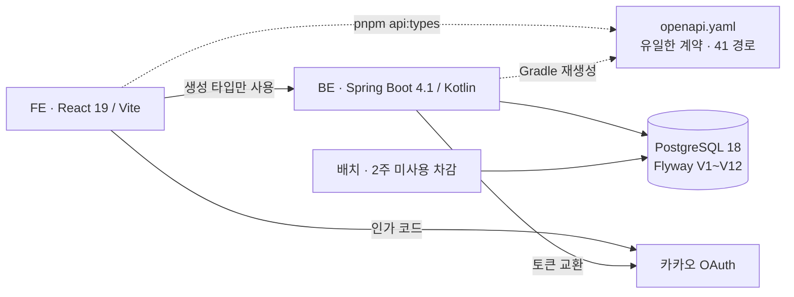
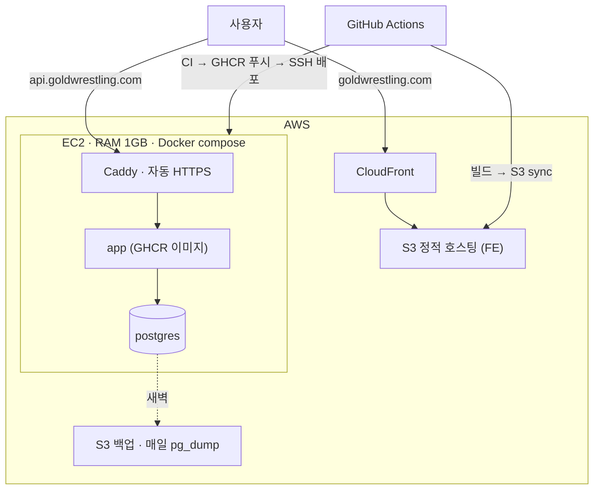

# 아키텍처

FE와 BE는 별도 레포이고 `openapi.yaml` 한 파일로만 만납니다. FE는 정적 파일(CSR), BE는 Spring Boot 단일 애플리케이션과 PostgreSQL입니다.

## 지킨 원칙

- **잔여 = 이력 합계.** 가감은 append-only 원장에만 기록하고 잔여 컬럼을 따로 갱신하지 않습니다.
- **동시성은 DB 제약이 마지막 방어선.** 1:1 슬롯 유니크, 정원 조건부 갱신, 배치 실행 `RUNNING` 부분 유니크.
- **서버 상태는 TanStack Query만 소유.** 서버 데이터를 클라이언트 스토어에 복제하지 않습니다.
- **에러는 `code`로만 분기.** 값 목록은 `error-codes.md`가 계약입니다.
- **같은 도메인 이름.** BE 패키지(`pass`, `reservation`, `attendance`…)와 FE feature 폴더가 같은 이름을 써서 두 레포의 AI 세션이 같은 문서를 찾습니다.

## 배포 목표 구성 계획

BE v1.1 Phase 7~9와 FE 배포 마일스톤에서 구현합니다. 아직 운영 중이 아닙니다.

| 항목 | 결정 |
| --- | --- |
| 인프라 | AWS 통일. EC2(BE+DB) + S3/CloudFront(FE) (D-006) |
| 서버 | RAM 1GB, 스왑 2GB, 세 컨테이너 메모리 예산표 |
| HTTPS | Caddy 자동 발급, 인증서 볼륨 영속. `/actuator`는 health만 외부 통과 (D-174) |
| 배포 | main push → CI 통과 후에만 이미지 빌드·배포, health `UP` 폴링 실패 시 빨간불 |
| 백업 | 매일 새벽 pg_dump → S3, 복구 리허설 1회 기록 |
| 부하 실증 | k6로 초과 예약 0건과 p95를 기록하고 D-098을 해소 |

준비 현황은 [프로젝트 현황](/status/)에 있습니다.
