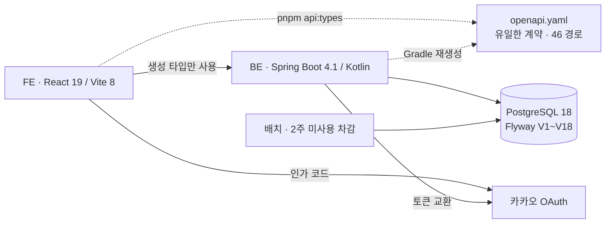
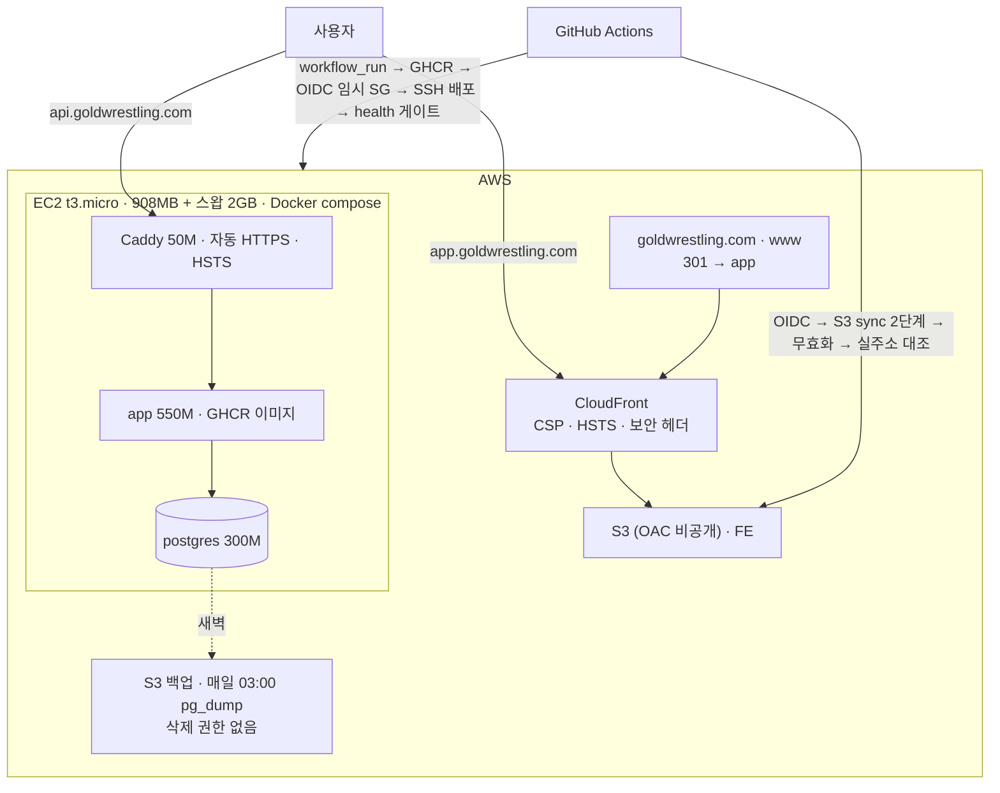

# 아키텍처

FE와 BE는 별도 레포이고 `openapi.yaml` 한 파일로만 만납니다. FE는 정적 파일(CSR), BE는 Spring Boot 단일 애플리케이션과 PostgreSQL입니다.

## 지킨 원칙

- **잔여 = 이력 합계.** 가감은 append-only 원장에만 기록하고 잔여 컬럼을 따로 갱신하지 않습니다.
- **동시성은 DB 제약이 마지막 방어선.** 1:1 슬롯 유니크, 정원 조건부 갱신, 배치 실행 `RUNNING` 부분 유니크.
- **서버 상태는 TanStack Query만 소유.** 서버 데이터를 클라이언트 스토어에 복제하지 않습니다.
- **에러는 `code`로만 분기.** 값 목록은 `error-codes.md`가 계약입니다.
- **같은 도메인 이름.** BE 패키지(`pass`, `reservation`, `attendance`…)와 FE feature 폴더가 같은 이름을 써서 두 레포의 AI 세션이 같은 문서를 찾습니다.
- **토큰은 스크립트가 못 읽는 곳에.** refresh는 HttpOnly 쿠키, access는 메모리. 브라우저 저장소에는 "쿠키가 있을 것" 힌트만 둡니다 (D-229, D-234).

## 운영 구성 운영 중

FE는 2026-10-24, BE는 2026-10-05(수동)·10-18(자동 배포)부터 운영 중입니다.

| 항목 | 결정 |
| --- | --- |
| 인프라 | AWS 통일. EC2(BE+DB) + S3/CloudFront(FE) (D-006, D-206) |
| 서버 | t3.micro, 스왑 2GB 전제, 컨테이너 상한 550M/300M/50M과 JVM `MaxRAMPercentage=60`을 실측으로 확정 (D-196) |
| HTTPS·헤더 | Caddy 자동 발급, HSTS는 Caddy 단독(D-235). `/actuator`는 health만, `/v3/api-docs`·`/swagger-ui`는 404. FE는 CloudFront에서 CSP enforce |
| 배포 | CI 성공 뒤 `workflow_run`, CI가 검증한 커밋만. health `UP` + 이미지 태그 대조로 성공 판정, 롤백은 `workflow_dispatch` (D-199~D-205, D-208) |
| 캐시 | FE `assets` immutable 1년 → `index.html` no-cache, `--delete` 금지, `/*` 무효화 (D-207) |
| 백업 | 매일 03:00 pg_dump → S3 조건부 업로드, 인스턴스 프로파일에 Delete 없음. 복구 리허설 RTO 약 1분 40초 (D-210, D-211, D-224) |
| 하드닝 | 컨테이너 `read_only`·`cap_drop ALL`·`no-new-privileges`, 컨테이너 → IMDS 차단, ufw·fail2ban, 액션 SHA 고정 (D-233, D-237) |
| 부하 실증 | k6로 초과 예약 0건과 p95를 기록하고 D-098을 해소 — Phase 10 예정 |

배포·운영의 실측값과 트러블슈팅은 [배포·운영 파이프라인](/highlights/deploy), 진행 상황은 [프로젝트 현황](/status/)에 있습니다.
