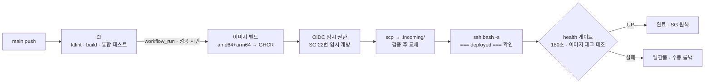

# 배포·운영 파이프라인

RAM 1GB 서버 한 대에서 운영할 서비스입니다. 사람이 서버에 들어가 명령을 치지 않아도 main 머지가 운영 반영으로 이어지고, 잘못 나갔을 때 되돌릴 수 있고, DB를 잃어도 복구할 수 있어야 했습니다. 세 가지를 모두 실제로 해 보고 걸린 시간을 숫자로 남겼습니다.

## 문제

- 서버는 t3.micro 한 대(실가용 RAM 908MB)입니다. JVM, PostgreSQL, 리버스 프록시가 같은 메모리를 나눠 씁니다.
- 배포 스크립트가 "성공"을 보고해도 실제로 새 이미지가 떠 있는지는 별개입니다. 첫 자동 배포가 정확히 이렇게 실패했습니다.
- 정적 FE는 배포 순간에 열려 있던 탭이 옛 청크를 요청합니다. 지우면 화면이 깨집니다.
- 백업은 "돌고 있다"만으로는 의미가 없습니다. 복원해 본 적이 없으면 없는 것과 같습니다.

## 결정

**BE — EC2 + Docker compose.** 메모리 예산표를 먼저 정하고 실측으로 확정했습니다 (D-196).

| 컨테이너 | 상한 | 부하 중 실측 |
| --- | --- | --- |
| app (JVM 힙 상한 330MiB, SerialGC) | 550M | 369.4MiB (67%) |
| postgres 18 (`shared_buffers=64MB`) | 300M | 34MiB |
| Caddy 2 (자동 HTTPS) | 50M | 24MiB |

부하 중 물리 메모리 여유가 183MB까지 내려가고 스왑을 최대 301M 써서, 스왑 2GB는 선택이 아니라 전제로 문서화했습니다. OOM은 0건입니다.

**BE 배포 흐름.**

| 결정 | 내용 |
| --- | --- |
| 트리거 | CI 성공 뒤 `workflow_run`으로만. CI가 검증한 `head_sha`를 배포하고, 그 사이 main이 앞서 나가면 건너뜀 (D-199) |
| 접속 | 장기 키 대신 OIDC 임시 권한으로 보안 그룹 22번을 배포 동안만 열고 닫음. 배포 전용 ed25519 키, 고정 known_hosts (D-200) |
| 전달 | compose·Caddyfile·백업 스크립트를 `.incoming/`에 받아 검증한 뒤 교체. 서버의 버전은 `image.env` 한 줄 (D-201, D-202) |
| 이미지 | amd64+arm64 멀티 아키텍처, 커밋 SHA 7자리 + `latest` 태그를 함께 푸시 (D-204) |
| 성공 판정 | 컨테이너가 떴다가 아니라 health `UP` + 실행 중 이미지 태그가 이번 SHA와 같을 때 |
| 롤백 | 자동 롤백 없음. `workflow_dispatch`에 이미지 태그를 주면 빌드를 건너뛰고 그 이미지로 배포 (D-203) |

**FE — S3 + CloudFront.** 비공개 버킷(OAC) 앞에 CloudFront, `app.goldwrestling.com`. 루트와 www는 경로·쿼리를 유지한 채 app으로 301합니다 (D-206).

| 결정 | 내용 |
| --- | --- |
| 업로드 순서 | `assets/`(해시 파일명)를 먼저 1년 immutable로, `index.html`을 마지막에 no-cache로 (D-207) |
| 삭제 | `--delete` 금지. 옛 청크는 남기고 버전 수명 규칙 30일로 정리 |
| 실주소 대조 | 운영 `index.html`이 가리키는 엔트리 청크가 방금 빌드와 같은지, 내려받아지는지, `/reservations` 새로고침이 200인지 |
| 빌드 검사 | 필수 환경값이 비면 실패, 번들에 실제로 들어갔는지 grep. MSW 워커 파일은 빌드와 버킷에서 모두 없음을 단언 |
| 권한 | 기본 `permissions: {}`, 액션 4개 커밋 SHA 고정, OIDC 역할로만 S3·CloudFront 접근 (D-208) |

**백업·복구.** 매일 03:00(미사용 차감 배치 04:00 직전) `pg_dump -Fc` → 검증 → S3 조건부 업로드(`--if-none-match`). EC2 인스턴스 프로파일에는 Put·Get·List만 있고 Delete가 없어 서버가 털려도 백업을 지울 수 없습니다 (D-210, D-211).

## 검증

| 항목 | 실측 |
| --- | --- |
| main 머지 → 운영 반영 | 약 8.5분 (CI 259초 + Deploy 254초) |
| 서비스 중단 구간 | 약 30초 (health 게이트 대기 24~26초) |
| 롤백 / 복귀 | 73초 / 74초 — image job을 건너뜀. 전후 `.env` sha256 불변, 임시 SG 규칙 잔존 0 |
| 자동 백업 | 3일 연속 무인 실행 rc=0, 각 5~6초. 같은 키 재업로드는 412, 삭제는 AccessDenied |
| 복구 리허설 | 임시 EC2에 서버 셋업부터 복원까지 RTO 약 1분 40초. 16개 테이블 행 수와 잔여·이력 합계 일치 |
| 위협 모델 | 운영 안전장치 페이즈 위협 46건 closed (대응 37 · 감수 9) |

첫 자동 배포는 실패했습니다. 원격 스크립트가 rc 0으로 중간에 끝났지만 health 게이트가 "실행 이미지 불일치"로 막아 운영에는 영향이 없었습니다. 원인(스크립트 안의 `docker compose run`이 stdin에서 남은 스크립트를 소비)을 리허설 하네스에서 재현한 뒤 고쳤습니다 (D-205). "성공 판정을 무엇으로 하느냐"가 이 파이프라인에서 가장 중요한 결정이었다는 것을 첫 배포가 증명했습니다.

**남은 것.** k6로 실 서버를 상대로 초과 예약 0건과 p95를 실증하고, 미사용 차감 cron을 3단계 절차로 켜는 일은 BE Phase 10에 남아 있습니다. 복구 RTO는 57KB 덤프 기준 하한이라 데이터가 늘면 다시 리허설합니다.

근거: [decisions.md](https://github.com/minsu-zip/gold-wrestling-be/blob/main/docs/decisions.md) D-196 · D-199~D-208 · D-210~D-212, BE `docs/operations.md` · `docs/metrics.md` §4~§6, FE `.github/workflows/deploy.yml`
