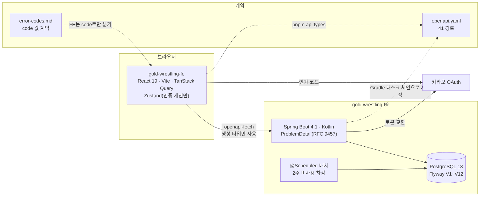
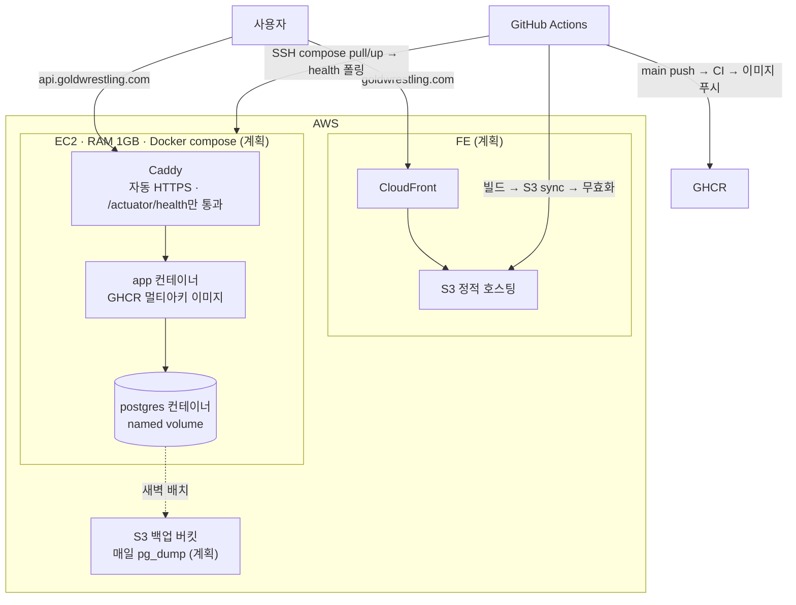

# 아키텍처

## 현재 구조 (v1.0)

FE와 BE는 별도 레포이고, `openapi.yaml` 한 파일로만 만난다. FE는 CSR 정적 파일이고, BE는 Spring Boot 단일 애플리케이션 + PostgreSQL이다.

### 도메인 모듈

BE 패키지와 FE feature 폴더가 같은 도메인 이름을 쓴다. 이름이 같으면 두 레포의 AI 세션이 같은 문서를 찾는다.

| 도메인 | BE `com.goldwrestling.*` | FE `src/features/*` |
| --- | --- | --- |
| 인증 | `auth`, `auth.kakao` | `auth` |
| 회원 | `member`, `admin` | `member` |
| 이용권 | `pass` | `pass` |
| 시간표·예약 | `schedule`, `reservation`, `branch` | `class-session`, `reservation` |
| 배치 | `batch` | (없음, 관리자 수동 실행만 호출) |
| 출석·공지·알림 | `attendance`, `notice`, `notification` | `attendance`, `notice`, `notification` |
| 공통 | `common.error`, `common.time`, `common.projection`, `config`, `system` | `lib`, `components/ui`, `components/common`, `app` |

### 데이터 흐름의 원칙

- **잔여 = 이력 합계.** `PassTransaction`은 append-only. 잔여 컬럼을 따로 갱신하지 않는다 (D-016, D-055).
- **동시성은 DB 제약이 마지막 방어선.** 1:1 슬롯 유니크, 정원 조건부 갱신, 배치 실행 `RUNNING` 부분 유니크 (D-021, D-117).
- **서버 상태는 TanStack Query만 소유.** 서버 데이터를 클라이언트 스토어에 복제하지 않는다.
- **에러는 `code`로만 분기.** 메시지 문자열이나 HTTP 상태를 조건으로 쓰지 않는다 (D-017, D-076).
- **시간은 Asia/Seoul, 주 시작은 월요일.** 서버는 Clock 주입, 클라이언트는 `src/lib/datetime.ts`.

## 배포 목표 구성 계획

BE v1.1 Phase 7~9와 FE 배포 마일스톤에서 구현한다. 아래는 결정된 목표이고, 아직 운영 중이 아니다.

| 항목 | 결정 | 근거 |
| --- | --- | --- |
| 인프라 | AWS 통일. EC2(BE+DB) + S3/CloudFront(FE) | D-006 |
| 서버 스펙 | RAM 1GB, 스왑 2GB, 세 컨테이너 메모리 예산표 | BE Phase 7 INFRA-05, `docs/operations.md` |
| HTTPS | Caddy 자동 발급, 인증서 볼륨 영속 | D-174, D-177 |
| 이미지 | 멀티스테이지 Dockerfile, amd64+arm64 매니페스트 1개, 비루트 실행 | BE Phase 7 INFRA-01, `docs/metrics.md` |
| 배포 트리거 | main push → CI 통과 후에만 이미지 빌드·배포, health `UP` 폴링 실패 시 빨간불 | BE Phase 8 DEPLOY-01~04 |
| 백업 | 매일 새벽 `pg_dump` → S3, 보관 30일, 복구 리허설 1회 기록 | BE Phase 9 OPS-01~03 |
| 부하 실증 | k6로 정원 N에 N+M 동시 예약, 1:1 슬롯 다수 동시 예약. 초과 예약 0건과 p95를 `docs/metrics.md`에 기록 | BE Phase 10 VERIFY-01~02, D-098 해소 |

인프라 준비 현황은 [프로젝트 현황](/status/)에 있다.
